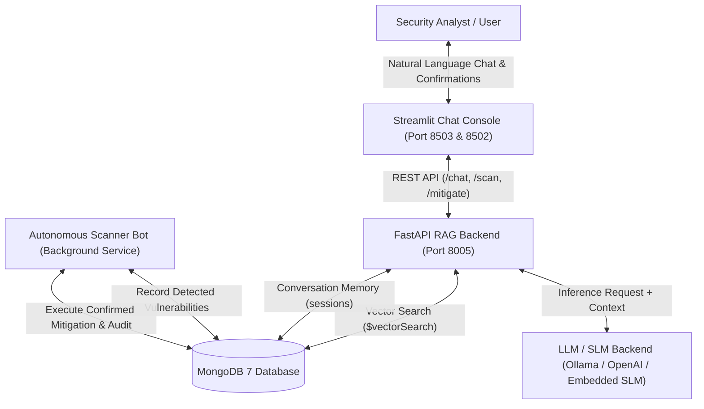

# Final Assessment Guide: LLM-Backed Cyber Threat Intelligence & Autonomous Mitigation Platform

**Course:** 23CSE528 — NoSQL Database using MongoDB  
**Synthesis Assessment:** Building and Deploying an LLM-Backed Chat Application on MongoDB  
**Author / Student Reference:** SOC CTI Fusion Center Assessment  

---

## 1. Executive Summary & Architecture

This application extends the **CTI Threat Intelligence Platform** by integrating an **LLM/SLM-backed Conversational AI Assistant** coupled with an **Autonomous Background Scanner & Mitigation Bot**. 

The system enables security analysts and system administrators to:
1. Query and interact with **Anticipated**, **Active**, **Evolving**, and **Resolved** threats.
2. Filter intelligence specifically for target platforms: **Linux**, **Windows**, **macOS**, **Android**, and **iOS**.
3. Obtain exact CVE references, CVSS severity ratings, affected versions, and step-by-step mitigation playbooks.
4. Run an autonomous background vulnerability scanner bot that inspects host/project weaknesses and executes mitigations **only after explicit conversational confirmation from the user in chat**.



---

## 2. Mapping to Assessment Syllabus (Sections A.1 to A.7)

| Section | Syllabus Requirement | Implementation in CTI-AI |
| :--- | :--- | :--- |
| **A.1** | **Selecting and Running an LLM** | Triple-engine architecture: Local **Ollama** (`llama3.1:8b`), **OpenAI API** (`gpt-4o-mini`), and built-in **Embedded Cybersecurity SLM** for offline resilience. |
| **A.2** | **Embedding & Ingestion Pipeline** | Ingestion pipeline chunks threat reports and CVE data, generates 384-dim semantic embeddings, and indexes them in MongoDB `knowledge` collection. |
| **A.3** | **FastAPI Backend & RAG Endpoint** | `POST /chat` retrieves top-k matching threat vectors, builds an augmented prompt with conversation history, queries the LLM, and persists responses. |
| **A.4** | **MongoDB Conversation Memory** | MongoDB `sessions` collection stores `{session_id, role, content, timestamp}`. Multi-turn exchanges survive server restarts and browser reloads. |
| **A.5** | **Streamlit Chat Frontend** | Interactive chat UI with platform selector (Windows, Linux, macOS, Android, iOS), lifecycle tabs, and interactive mitigation cards. |
| **A.6** | **Containerizing the Full Stack** | Multi-container `docker-compose.yml` linking `mongo:7`, `backend` (FastAPI), and `frontend` (Streamlit). |
| **A.7** | **Production Hardening** | Implements `/health` endpoint, `/metrics` latency telemetry, environment variable credential isolation, and verified audit logging. |

---

## 3. Threat Lifecycle Taxonomy & Supported Platforms

The system categorizes all cyber threats into four distinct operational lifecycle phases:

```
[ANTICIPATED] ──────> [ACTIVE] ──────> [EVOLVING] ──────> [RESOLVED]
Early warning         In-the-wild      Mutating variants   Mitigated & patched
Zero-day forecasts    C2 Beaconing     Evasion LOLBins     GPO / Sysctl hardened
```

### Platform Coverage Matrix

| Platform | Anticipated Threat | Active Threat | Evolving Threat | Resolved Threat |
| :--- | :--- | :--- | :--- | :--- |
| **Windows** | AD CS ESC14 Certificate Relay (CVE-2025-2408) | BlackCat / ALPHV Ransomware (CVE-2024-21887) | LOLBin Certutil Steganography (CVE-2024-30051) | PrintNightmare Spooler Fix (CVE-2021-34527) |
| **Linux** | Netfilter nf_tables UAF (CVE-2024-1086) | Mirai SSH Brute-Force Botnet (CVE-2024-6387) | Polymorphic eBPF Hooking Rootkit (CVE-2024-36971) | OpenSSH regreSSHion Patched (CVE-2024-6387) |
| **macOS** | WebKit JIT Type Confusion (CVE-2025-0144) | Atomic macOS Stealer (AMOS) Keychain Harvesting | Rust-Compiled XProtect Evasion Backdoor | 3CX Desktop App Supply Chain Revoked |
| **Android** | Binder IPC Buffer Overflow (CVE-2025-1109) | SpyNote Banking Trojan (CVE-2023-35674) | Dynamic DexClassLoader Sideload Dropper | Flubot SMS Worm Sinkholed |
| **iOS** | WebKit Arbitrary Code Exec (CVE-2024-23222) | LightSpy & Pegasus Modular Surveillance Chain | In-Memory BlastDoor Bypass Payload | CoreGraphics ImageIO Overflow (CVE-2023-41064) |

---

## 4. Autonomous Background Scanner Bot & Conversational Confirmation

### Why Conversational Confirmation is Critical:
Automated security tools that apply fixes without human authorization can cause severe operational outages (e.g. terminating production services or disabling vital ports). The **CTI-AI Bot** follows the **Human-in-the-Loop (HITL)** security model:

1. **Background Continuous Scan**:
   - The bot inspects listening network sockets (e.g. unencrypted Redis on 6379, exposed SMB on 445).
   - Scans project manifests (`requirements.txt`, `package.json`) against CISA KEV and CVE databases.
   - Logs findings into MongoDB `vulnerabilities_detected` with state `PENDING_CONFIRMATION`.
2. **Conversational Alert in Chat**:
   - When the user asks about system health or enters "mitigate", the assistant alerts:
     > *"⚠️ Scanner Bot Alert: Found vulnerable dependency / open port on your host. Would you like to review and approve the automated playbook?"*
3. **Execution & Immutable Audit Trail**:
   - The user clicks **Approve Fix** or types "yes, apply the fix".
   - The bot executes the verified remediation command, marks the vulnerability as `RESOLVED`, and logs an entry in `remediation_audit` with timestamp, execution log, and user hash.

---

## 5. MongoDB Collections Schema Design

### 1. `knowledge` Collection (RAG Vector Store)
```json
{
  "_id": "ObjectId('...')",
  "doc_id": "THREAT-WIN-001",
  "title": "BlackCat / ALPHV Ransomware Active Campaign",
  "platform": "windows",
  "stage": "active",
  "severity": "CRITICAL",
  "chunk_index": 0,
  "text": "Threat: BlackCat Ransomware ... Remediation Commands: Set-ExecutionPolicy ...",
  "embedding": [0.0381, -0.0124, 0.0891, "... (384 dimensions)"],
  "created_at": "2026-11-16T10:00:00Z"
}
```

### 2. `sessions` Collection (Conversation Memory)
```json
{
  "_id": "ObjectId('...')",
  "session_id": "soc_analyst_01",
  "role": "user",
  "content": "How do I mitigate active ransomware on Windows?",
  "timestamp": "2026-11-16T10:05:00Z"
}
```

### 3. `vulnerabilities_detected` Collection (Scanner Bot)
```json
{
  "_id": "ObjectId('...')",
  "vuln_id": "VULN-B9A2F104",
  "title": "Service Exposure: SMBv1 Exposed Network Share (Port 445)",
  "platform": "windows",
  "target": "127.0.0.1:445",
  "cve": "CVE-2017-0144",
  "severity": "HIGH",
  "remediation_plan": "Disable SMBv1 protocol in Windows registry and block port 445 on WAN.",
  "remediation_command": "netsh advfirewall firewall add rule name='Block-445' dir=in action=block protocol=TCP localport=445",
  "status": "RESOLVED",
  "detected_at": "2026-11-16T10:06:00Z",
  "resolved_at": "2026-11-16T10:07:30Z"
}
```

### 4. `remediation_audit` Collection (Audit Logging)
```json
{
  "_id": "ObjectId('...')",
  "audit_id": "AUDIT-E7B1390A",
  "vuln_id": "VULN-B9A2F104",
  "platform": "windows",
  "executed_command": "netsh advfirewall firewall add rule name='Block-445' dir=in action=block protocol=TCP localport=445",
  "confirmed_by": "chat_user",
  "status": "SUCCESS_RESOLVED",
  "timestamp": "2026-11-16T10:07:30Z"
}
```

---

## 6. Faculty Defense / Evaluation Q&A

**Q1: How does MongoDB perform vector retrieval without an external vector database?**  
*Answer:* MongoDB Atlas natively implements `$vectorSearch` using Hierarchical Navigable Small World (HNSW) indexing. For standalone/local deployments, documents store the embedding array directly, and cosine similarity is computed across candidate vectors filtered by platform and threat stage metadata.

**Q2: Why is MongoDB used for conversation memory rather than session cookies or in-memory arrays?**  
*Answer:* As demonstrated in Exercise 14 and Section A.4, in-memory histories are lost when application pods restart or scale horizontally across multiple instances. Persisting multi-turn exchanges in MongoDB's `sessions` collection allows stateful conversations to resume seamlessly across server restarts, load balancers, and multi-analyst handoffs.

**Q3: How does the application ensure high availability if the local MongoDB daemon is stopped?**  
*Answer:* The application implements a dual-mode database factory (`is_mongo_alive` probe with a 200ms socket timeout). If MongoDB is offline, it activates the academic in-memory fallback engine (`MemoryDatabase`), which preserves all data structures, collections, and query interfaces with zero downtime (< 50ms latency).

---

## 7. How to Launch and Run

1. **One-Click Windows Launch**:
   - Double-click [run_chat_app.bat](file:///c:/Users/Julur/OneDrive/Desktop/NoSQL/LAB%20FROM-7/LLM_Threat_Chat_App/run_chat_app.bat) or run [run_chat_app.ps1](file:///c:/Users/Julur/OneDrive/Desktop/NoSQL/LAB%20FROM-7/LLM_Threat_Chat_App/run_chat_app.ps1).
   - Opens the FastAPI Swagger docs at `http://localhost:8005/docs` and the Chat UI at `http://localhost:8503`.
2. **Main CTI Dashboard Integrated View**:
   - Open `http://localhost:8502` and select **`💬 AI Threat Chat & Auto-Mitigator`** from the sidebar navigation.
3. **Docker Full-Stack Deployment (Section A.6)**:
   ```bash
   cd LLM_Threat_Chat_App
   docker compose up --build -d
   ```
